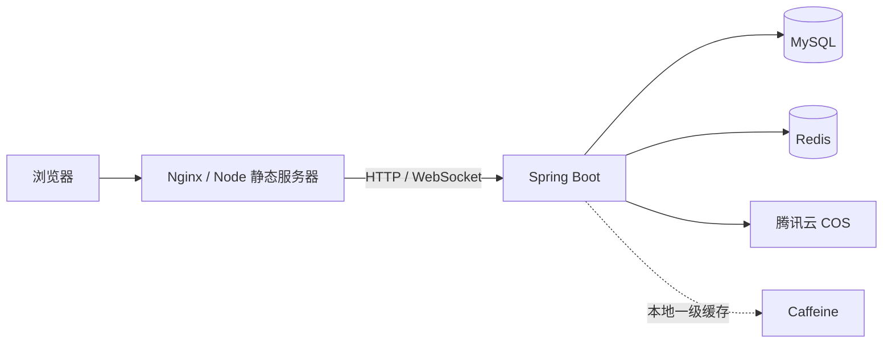

# 证链 TraceProof

面向快递、物流网点的异常件影像取证与档案管理平台。覆盖破损、丢失、污染、延误、错分等场景，支持影像上传、审核定责、公共案例库、私有/团队档案库、多人协同核对和统计分析。

后端采用 Spring Boot + MyBatis-Plus + Sa-Token + MySQL + Redis + 腾讯云 COS；前端采用原生 HTML、CSS 和 ES Module，无需前端构建。

## 功能

| 模块 | 能力 |
| --- | --- |
| 影像取证 | 本地多文件上传、拖拽上传、URL 导入、管理员批量采集；前端压缩，后端校验真实格式与大小 |
| 影像处理 | 腾讯云数据万象生成 WebP 缩略图、读取尺寸和主色调；列表加载缩略图，详情查看原图 |
| 案例浏览 | 关键词搜索、分类筛选、时间/体积排序、主色调相似筛选、分页、筛选重置和失败重试 |
| 审核定责 | 公共案例库待审核、通过、拒绝和改判；详情展示审核状态、审核说明和审核时间 |
| 我的影像 | 查看自己的公共影像，支持编辑、重传、删除和审核状态跟踪 |
| 档案库 | 公共案例库、私有档案库、团队档案库；数量和容量配额、用量进度、重命名和删除 |
| 团队协作 | 按昵称邀请成员，viewer / editor / admin 角色，成员退出和权限控制 |
| 协同核对 | WebSocket 同步缩放和旋转，同一时刻仅一人持有操作权；不修改原始影像 |
| 统计分析 | 容量/数量仪表盘、分类分布、标签词云、大小分布、上传趋势、管理员排行和 CSV 导出 |
| 用户管理 | 注册、登录、昵称维护、角色管理、用户搜索、新增、编辑和删除 |
| 前端体验 | 响应式导航、小屏单列卡片、骨架屏、错误反馈、批量失败重试、键盘操作和焦点管理 |

## 技术栈

| 分类 | 选型 |
| --- | --- |
| 语言与构建 | Java 17、Maven 3.8+ |
| 后端 | Spring Boot 2.6.13、Spring MVC、Spring AOP |
| 数据访问 | MyBatis-Plus 3.5.9、MySQL 8、逻辑删除、雪花 ID |
| 分表 | ShardingSphere-JDBC 5.2.0，团队档案库按 `archiveId` 动态分表 |
| 认证与权限 | Sa-Token 1.39.0，全局角色 + 档案库角色，HttpOnly Cookie |
| 缓存与协调 | Caffeine、Redis、Redisson（锁、布隆过滤器、限流） |
| 实时通信 | Spring WebSocket、LMAX Disruptor |
| 对象存储 | 腾讯云 COS + 数据万象 |
| 前端 | 原生 ES Module、ECharts 按需加载、Node.js 静态开发服务器 |
| 测试 | JUnit 5、Mockito、Node 冒烟/E2E/并发脚本 |
| 部署 | Docker 多阶段构建、Docker Compose、Nginx |

## 系统结构



主要链路：

1. **上传**：权限与配额校验 → 格式/大小校验 → 临时文件 → COS 原图与缩略图 → 元数据入库 → 更新档案库用量 → 清理本地缓存。
2. **公共列表**：Caffeine → Redis → MySQL；只缓存与身份无关的公共已过审数据。
3. **影像访问**：浏览器直接访问 COS，后端不代理图片流量。
4. **协同核对**：握手鉴权 → Disruptor 消费消息 → 操作权校验 → 同图会话广播。

## 目录

```text
.
├── src/main/java/com/traceproof/   # 后端源码
│   ├── controller/                # 接口、鉴权与限流切面
│   ├── service/                   # 业务逻辑
│   ├── manager/                   # COS、上传、Redisson、动态分表
│   ├── websocket/                 # 协同核对与 Disruptor
│   ├── model/                     # 实体、DTO、VO、枚举
│   └── conifg/                    # 配置类（保留现有包名）
├── src/main/resources/            # application.yml 与权限配置
├── src/test/java/                 # 后端测试
├── front/                         # 原生前端
│   ├── js/views/                  # 页面
│   ├── js/components/             # 上传、详情、查看器、协同核对
│   ├── lib/                       # 本地 ECharts 与词云扩展
│   └── server.js                  # 开发静态服务器与 API 代理
├── deploy/                        # Compose、Nginx、SQL、部署脚本
├── sql/                           # 独立建表与迁移脚本
└── docs/                          # 部署文档
```

## 本地运行

### 环境要求

- JDK 17（推荐用于构建和运行）
- Maven 3.8+
- Node.js 18+
- MySQL 8
- Redis 7
- 腾讯云 COS 存储桶，并开启数据万象

> **Redis 是必需依赖，不只是可选缓存。** 登录会话、分布式锁、限流和布隆过滤器都依赖 Redis。旧的免 Redis 编排不能作为功能完整的部署方案。

### 1. 初始化数据库

```bash
mysql -uroot -p < deploy/mysql/init.sql
```

脚本创建 `user`、`evidence`、`archive`、`archive_user` 四张基础表。团队档案库的 `evidence_<archiveId>` 分表由应用按需创建，无需手工执行。

已有数据库升级时，按实际版本执行 `deploy/mysql/migration-*.sql`，不要通过删除数据卷重建环境。

### 2. 配置本地密钥

创建 `src/main/resources/application-local.yml`（已被 `.gitignore` 排除）：

```yaml
spring:
  datasource:
    username: root
    password: <你的数据库密码>
  redis:
    database: 0
    host: 127.0.0.1
    port: 6379
    password: <你的 Redis 密码，无密码可留空>

cos:
  client:
    host: https://your-bucket-appid.cos.ap-guangzhou.myqcloud.com
    secretId: <你的 SecretId>
    secretKey: <你的 SecretKey>
    region: ap-guangzhou
    bucket: your-bucket-appid
```

不要把真实密码、COS 密钥或 `deploy/.env` 提交到仓库。

### 3. 启动后端

```bash
mvn spring-boot:run
```

也可以打包后运行：

```bash
mvn clean package -DskipTests
java -jar target/traceproof-0.0.1-SNAPSHOT.jar
```

后端地址：`http://localhost:8666/api`。

Knife4j 默认关闭；本地需要接口文档时设置：

```bash
KNIFE4J_ENABLE=true mvn spring-boot:run
```

### 4. 启动前端

```bash
cd front
node server.js
```

访问 `http://localhost:8667`。默认前端直连 `http://localhost:8666/api`；如果希望通过 Node 的同源代理访问，在 `front/config.js` 中设置：

```js
window.__API_BASE__ = '/api';
```

Redis 已启动时，也可以把 `window.__USE_CACHE__` 设为 `true`，让公共首页使用多级缓存接口。

### 5. 创建管理员

先通过页面注册账号，再执行：

```sql
UPDATE user SET userRole = 'admin' WHERE userAccount = '你的账号';
```

## 核心设计

### 上传与 URL 导入

- 本地文件和 URL 导入共用模板方法，统一处理临时文件、对象存储和结果封装。
- 支持 JPG、JPEG、PNG、WebP，单张业务上限 2 MB。
- URL 导入仅允许公网 HTTP/HTTPS 地址，校验 DNS 解析结果和重定向目标，阻止回环、私网、链路本地及云元数据地址。
- 不只信任后缀或 `Content-Length`：下载时限制实际字节数，并按文件头识别真实格式。
- 上传失败或部分成功时保留失败任务，支持仅重试失败项。

### 缓存与查询

- 公共列表采用 Caffeine + Redis 两级缓存，MySQL 兜底。
- 缓存键包含完整规范化查询条件，标签顺序不影响结果。
- Redis 使用带随机抖动的 TTL；写操作立即清本地缓存，Redis 旧数据依靠 TTL 过期。
- 排序字段和方向使用服务端白名单；公共分页每页最多 20 条，全局分页插件上限 100 条。

### 审核与权限

- `archiveId = 0` 表示公共案例库，普通用户上传后必须审核。
- 私有/团队档案库影像不参与公共审核，但仍受档案库权限约束。
- 公共未过审详情仅上传者和管理员可见，其他人不能通过 ID 直接访问。
- 团队权限同时由接口注解和业务层校验，不能只依赖前端隐藏按钮。

### 前端性能与可用性

- 页面路由和 ECharts 均按需加载，避免首屏加载约 1 MB 的图表库。
- 图表实例复用，路由离开后释放实例、监听器和异步状态。
- 请求支持超时与取消；搜索、颜色和筛选请求防止旧响应覆盖新状态。
- 查看器支持缩放、拖拽、真正 1:1、缩略图导航、键盘操作和焦点恢复。
- 适配窄屏导航、成员弹窗、卡片操作区和全屏工具栏。

## 测试

### 后端

```bash
mvn test
```

覆盖查询条件、排序白名单、缓存键、审核权限、上传与 URL 安全、COS 删除、档案库权限和 Spring 上下文。

其中 `@SpringBootTest` 会使用本地配置，因此完整测试前需要可用的本地 MySQL 和 Redis；不要让测试配置指向生产环境。

### 前端

```bash
cd front
node smoke-test.mjs
node e2e-test.mjs
```

- `smoke-test.mjs`：真实加载 13 个前端模块，检查语法、导入和主要渲染流程。
- `e2e-test.mjs`：需要真实后端，覆盖登录、分页、上传、档案库和权限链路。
- 可用 `API_BASE=http://localhost:8666/api node e2e-test.mjs` 指定后端。

并发脚本仅用于测试环境：

```bash
node concurrency-test.mjs --users 5 --http 50
```

不要在 2 核 2 GiB 的生产机器上直接运行高并发压测。

## 低配运行基线

针对 2 核 2 GiB、单实例、低并发部署，当前默认资源起点如下：

| 项目 | 配置 |
| --- | --- |
| JVM | `-Xms128m -Xmx512m`、Metaspace 256 MB、SerialGC |
| Tomcat | 最大 50 工作线程 |
| Hikari | 最大 10 连接 |
| Redisson | 最大 8 连接，最小空闲 2 |
| Caffeine | 最多 500 项，初始容量 128 |
| Disruptor | RingBuffer 4096，消费后清理引用；每图仅保留最新绝对快照，满队列快速失败 |
| MySQL | InnoDB Buffer Pool 128 MB，关闭 Performance Schema |
| Redis | MaxMemory 192 MB，不盲目启用全量 LRU 淘汰 |

Docker Compose 方案包含 MySQL、Redis、后端和 Nginx；部署脚本在小于 3 GiB 内存时自动选择精简资源编排，但不会删除 Redis：

```bash
cp deploy/.env.example deploy/.env
# 编辑 deploy/.env，填入真实数据库密码和 COS 配置
chmod 600 deploy/.env
bash deploy/deploy.sh
```

部署前请阅读：

- [通用部署说明](docs/deploy.md)
- [阿里云 ECS 部署说明](docs/deploy-aliyun.md)
- [HTTPS 配置](deploy/nginx/https.conf)

> 2 GiB 机器建议在本机或 CI 构建镜像，再部署到 ECS，避免 Maven 构建与运行服务争抢内存。不要再同机加入 Elasticsearch、Kafka、ELK 等重型组件。

## 已知限制与后续方向

- 团队档案库采用“一库一分表”，部分无 `archiveId` 的 CRUD 会广播到多个分表；数据量增长前应评估回迁单表与复合索引，而不是继续加分表。
- Redis 公共列表缓存依赖 TTL 过期，写入后短时间内可能出现旧数据；需要强一致时应引入版本化缓存键。
- 当前密码仍为固定盐 MD5，后续应迁移到 BCrypt 或 Argon2，并在老用户登录时渐进重 hash。
- COS 对象当前为公有读；如果私有档案库需要真正内容私密，应改成私有对象和短时签名 URL。
- 协同核对只同步视图状态，不提供裁剪、标注、版本保存或证据原件修改。
- AI 辅助定责、OCR 运单识别、操作审计和消息通知可作为后续业务增强，但不应在低配服务器上盲目增加中间件。

## 相关文档

- [前端说明](front/README.md)
- [部署说明](docs/deploy.md)
- [阿里云部署说明](docs/deploy-aliyun.md)
- [生产部署与更新手册](docs/deploy-runbook.md)
- [环境变量模板](deploy/.env.example)

项目早期参考公开课程项目的工程设计，之后围绕物流异常件取证业务完成领域模型、审核、档案库、团队协作、缓存和部署体系重构。
